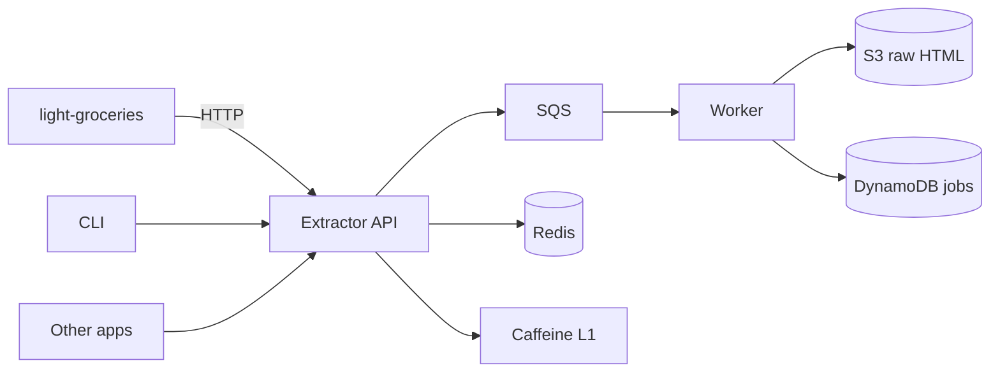

# Architecture — RecipeExtractor

## Goals

- Build a standalone recipe extraction service with a consumer-agnostic API.
- Extract sections independently: ingredients, instructions, title, servings, metadata.
- Support URL, raw HTML, and plain text sources.
- Report provenance and warnings; partial success is a first-class result.
- Practice Java 25, AWS SDK v2, LocalStack, S3, SQS, DynamoDB, Redis, and Caffeine.
- Integrate with light-groceries as one client without coupling the extractor to the app.

## Non-goals

- Replacing light-groceries' catalog matcher.
- Storing user recipes as a system of record.
- Scraping at scale.
- LLM-based extraction in v1.
- A Lambda deployment; the worker is a plain Java process.

## Design principles

1. **Standalone first.** The extractor has no dependency on light-groceries or its domain types.
2. **Sections, not all-or-nothing.** A consumer can ask for only ingredients or only instructions.
3. **Provenance matters.** Every section says where it came from and how confident it is.
4. **Core is portable.** `extractor-core` is pure Java; HTTP, AWS, and Redis are adapters.
5. **Cache the full result, filter on output.** One URL is extracted once; consumers request views.

## Context



## Modules

```text
recipe-extractor/
  extractor-core/      # pure Java 25: domain, strategies, merge, validation
  extractor-api/       # HTTP API, OpenAPI, request validation
  extractor-worker/    # SQS consumer, S3 archive, DynamoDB job state
  extractor-cli/       # local extraction and batch commands
  extractor-testkit/   # HTML fixtures, golden JSON, contract helpers
```

Dependency rule:

```text
api -> core
worker -> core
cli -> core
testkit -> core
core -> no Spring, no AWS, no Redis
```

## Domain model

```java
public sealed interface Source permits UrlSource, HtmlSource, TextSource {}

public record UrlSource(URI url) implements Source {}
public record HtmlSource(String html, URI baseUrl) implements Source {}
public record TextSource(String text) implements Source {}

public enum Section { TITLE, SERVINGS, INGREDIENTS, INSTRUCTIONS, METADATA }

public record RecipeDocument(
    String title,
    Integer servings,
    List<String> ingredients,
    String instructions,
    Map<String, String> metadata
) {}

public record ExtractionRequest(
    Source source,
    Set<Section> include,
    Set<Section> require,
    Options options
) {}

public record ExtractionResult(
    Source source,
    RecipeDocument recipe,
    Map<Section, Provenance> provenance,
    List<Warning> warnings
) {}

public enum Provenance { JSON_LD, MICRODATA, TEXT_SECTION, HEURISTIC }
```

`include` controls the response. `require` controls strictness: if a required section is missing,
return `422 MISSING_SECTIONS` but still include the sections that were found.

## API

### Single extraction

```http
POST /v1/extract
{
  "source": { "type": "url", "url": "https://example.com/borscht" },
  "include": ["ingredients", "instructions"],
  "require": ["ingredients"],
  "options": { "language": "ru", "timeoutMs": 10000 }
}
```

```json
{
  "source": { "type": "url", "url": "...", "finalUrl": "...", "fetchedAt": "..." },
  "recipe": {
    "title": "Борщ",
    "servings": 4,
    "ingredients": ["1 кг свёклы", "200 г капусты"],
    "instructions": "1. ...\n2. ..."
  },
  "provenance": {
    "ingredients": "json-ld",
    "instructions": "text-section"
  },
  "warnings": ["INSTRUCTIONS_LOW_CONFIDENCE"]
}
```

### Batch

```http
POST /v1/extractions
{
  "requests": [
    { "source": { "type": "url", "url": "..." }, "include": ["ingredients"] },
    { "source": { "type": "url", "url": "..." }, "include": ["instructions"] }
  ]
}
-> 202 { "jobs": [{ "id": "...", "status": "QUEUED" }] }
```

```http
GET /v1/extractions/{id}?include=ingredients
GET /v1/extractions/{id}/status
```

### CLI

```bash
recipe-extractor extract --url https://example.com/borscht --only ingredients
recipe-extractor extract --file page.html --only instructions
recipe-extractor batch urls.txt --only full --out results/
```

## Extraction pipeline

1. **Fetch** (for URL sources):
   - only `http`/`https`;
   - resolve every host and redirect target;
   - block loopback, private, link-local, and metadata ranges;
   - max 3 redirects, 10 s timeout, 2 MB limit;
   - respect `robots.txt` and per-domain rate limits.
2. **Parse** with strategies:
   - `JsonLdStrategy` — `schema.org/Recipe`, `@graph`, `@type` arrays, `HowToStep`/`HowToSection`.
   - `MicrodataStrategy` — `itemprop=recipeIngredient`, `recipeInstructions`.
   - `TextSectionStrategy` — en/ru headings, bullet fallback.
   - `HeuristicStrategy` — last-resort patterns.
3. **Merge** by field and confidence:
   - title from JSON-LD, ingredients from microdata, instructions from text is a valid result;
   - equal confidence resolves by strategy order.
4. **Filter** by `include`.
5. **Validate** `require`; return `422 MISSING_SECTIONS` with partial data if needed.
6. **Cache** the full result by URL hash + parser version.

## Storage and AWS

### LocalStack

```yaml
services:
  localstack:
    image: localstack/localstack:latest
    ports: ["4566:4566"]
    environment:
      SERVICES: s3,sqs,dynamodb,sns
  redis:
    image: redis:8-alpine
    ports: ["6379:6379"]
```

LocalStack Community is enough for S3, SQS, DynamoDB, and SNS. Do not depend on Lambda or Step
Functions; the worker is a plain Java process.

### S3

- `raw/{urlHash}/{jobId}.html` — raw page for debugging and reprocessing.
- `results/{urlHash}/{parserVersion}.json` — extracted `RecipeDocument`.
- Lifecycle: expire raw HTML after 30 days.

### SQS

- `recipe-extraction` — main queue.
- `recipe-extraction-dlq` — failed after N attempts.
- Visibility timeout > p99 extraction time; idempotency by `jobId`.

### DynamoDB

| Attribute | Value |
|---|---|
| PK | `JOB#{jobId}` |
| SK | `META` |
| status | `QUEUED`, `PROCESSING`, `DONE`, `FAILED` |
| urlHash | SHA-256 of normalized URL |
| attempts | number |
| parserVersion | semantic version |
| ttl | epoch seconds |

GSI: `urlHash-index` for deduplication and cache lookup. TTL removes old jobs automatically.

### Redis + Caffeine

- L1 Caffeine: `urlHash + include` → result, 10 min, max 10k, `recordStats()`.
- L2 Redis: full `RecipeDocument` JSON, 24 h, negative cache 5 min.
- Dedupe: `SETNX extract:lock:{urlHash}`; if a job is already running, return its ID.
- Rate limit: token bucket per domain.
- Cache key includes `parserVersion`; bump it to invalidate.

## Integration with light-groceries

The extractor never imports light-groceries classes. The app owns the adapter:

```text
light-groceries
  -> RecipeExtractorClient (HTTP, OpenAPI)
  -> map RecipeDocument to the app's ExtractedRecipe
  -> IngredientLineParser
  -> CatalogIngredientMatcher
  -> review screen
  -> save
```

Suggested integration points:

- `POST /api/recipes/import/extract/full` — full import through the extractor.
- `POST /api/recipes/import/extract/ingredients` — ingredients only; useful in the recipe editor.
- `POST /api/recipes/import/extract/instructions` — steps only; "extract steps from URL".
- `POST /api/recipes/import/extractions` — batch import with progress.

Feature flag: `app.import.extractor.enabled` and `app.import.extractor.base-url`. If the extractor
is unavailable, fall back to the existing Kotlin importer.

## Database decision: DynamoDB for jobs, not PostgreSQL

### Why DynamoDB

- Job state is key-value: `jobId` → status, attempts, timestamps.
- TTL removes old jobs automatically.
- GSI by `urlHash` supports deduplication.
- No joins, no complex reporting.
- It is a deliberate AWS learning goal.

### Why not PostgreSQL

- A `jobs` table with `FOR UPDATE SKIP LOCKED` is a perfectly good queue for a small project.
- PostgreSQL would be simpler to operate locally and gives SQL reporting.
- But it would not exercise the AWS SDK and managed-service patterns.

### Why not MongoDB here

- `RecipeDocument` itself is a natural document, so MongoDB would be a good choice if the service
  starts storing a recipe library.
- Job state is not a document aggregate; DynamoDB is a better fit for key-value + TTL.

### Verdict

Use DynamoDB for job state, S3 for blobs, Redis/Caffeine for cache. If the project grows into a
recipe library, add MongoDB for `RecipeDocument` and keep jobs in DynamoDB. If it stays small and
local, PostgreSQL would be the pragmatic single-database choice.

## Security

- SSRF protection on every URL and redirect.
- Block `file:`, `javascript:`, `data:`, and credentials in URLs.
- Limit response size and time.
- Respect `robots.txt` and per-domain rate limits.
- Do not log full HTML or URLs with secrets.
- No arbitrary code execution in the worker.
- Treat extracted HTML as untrusted input; never render it directly.

## Testing strategy

- Unit: each strategy against HTML fixtures.
- Golden tests: input HTML → expected `RecipeDocument` JSON.
- Merge tests: title from JSON-LD + instructions from text.
- SSRF tests: private IP, redirect to private IP, DNS rebinding.
- Integration: Testcontainers LocalStack + Redis.
- Contract: OpenAPI schema tests.
- Benchmark: 30 real recipe URLs; compare with the light-groceries Kotlin importer.

## Observability

- Micrometer counters: `extraction_total{status,strategy}`, `cache_hits_total{layer}`.
- Timer: extraction duration by domain.
- Structured logs with `requestId`, `jobId`, `urlHash`, `parserVersion`.
- `/actuator/health`, `/actuator/metrics`, optional Prometheus + Grafana.

## Roadmap

1. `extractor-core` + JSON-LD strategy + CLI.
2. Microdata + text-section strategies + merge.
3. HTTP API + OpenAPI.
4. Redis + Caffeine cache.
5. LocalStack: S3 + SQS + DynamoDB.
6. Batch jobs + retries + DLQ.
7. light-groceries adapter + feature flag.
8. Benchmark and README results.
